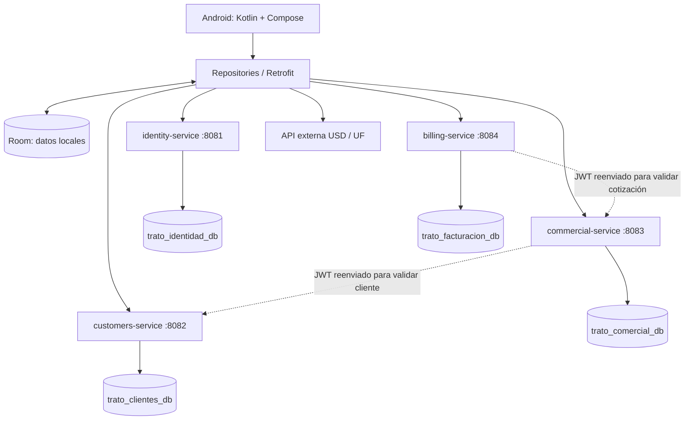

# Arquitectura lógica de Trato Hecho

## Límites de servicio

- **Identidad:** tenants, cuentas, roles, autenticación, refresh token.
- **Clientes:** datos de clientes y sus estados.
- **Comercial:** productos/servicios de catálogo, impuestos, cotizaciones, líneas y seguimiento.
- **Facturación:** registro interno que toma moneda y montos desde una cotización aceptada.

Cada servicio escribe solamente en su propia base de datos. Las referencias entre límites (por ejemplo, `customerId` y `quoteId`) son UUID opacos; la existencia/acceso se verifica con una llamada HTTP autenticada al servicio propietario cuando el proceso lo requiere.

## Seguridad multi-tenant

El `identity-service` agrega al JWT los claims `sub`, `tenantId` y `roles`. Los demás servicios validan la firma y toman el `tenantId` del principal del servidor. No se permite que Android elija el tenant mediante parámetros, encabezados o campos de DTO. Los repositorios consultan siempre por el `tenantId` obtenido del token.

## Flujo de cotización a facturación

1. Android crea/selecciona un cliente usando `customers-service`.
2. Android crea la cotización en `commercial-service`; este verifica cliente activo en `customers-service` propagando el Bearer token.
3. Comercial calcula subtotal, impuesto y total en el backend a partir de la cantidad, precio unitario y tasa vigente seleccionada.
4. La cotización avanza `BORRADOR -> ENVIADA -> ACEPTADA` (o RECHAZADA/VENCIDA).
5. Facturación solicita crear un registro enviando solo el `quoteId`; `billing-service` consulta `commercial-service`, verifica `ACEPTADA` y toma allí importes/moneda.

## Sincronización offline

Room conserva los borradores y estados de sincronización. En las altas POST de clientes y cotizaciones, Android envía una `Idempotency-Key` estable por operación. El servicio persiste la relación clave/recurso en la misma base y transacción del alta; repetir la misma clave para el mismo tenant y tipo devuelve el mismo recurso.
